# DevDock

A menu-bar / tray app for a frontend developer's daily chores: local git repos, Bitbucket pull
requests, Jenkins builds, Jira tickets, and the small tools in between (ports, env profiles,
caches, quick links, standup). Click the icon for one-click actions; open the app only when you
need the detail. It works fully offline in **demo mode**, which is on until you turn it off.

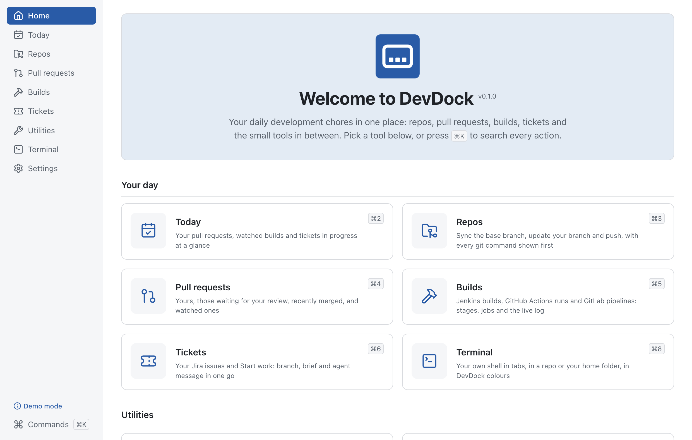

The full specification is in [`docs/SPEC.md`](docs/SPEC.md), design decisions in
[`docs/DECISIONS.md`](docs/DECISIONS.md), progress in [`docs/PROGRESS.md`](docs/PROGRESS.md) and
release notes in [`CHANGELOG.md`](CHANGELOG.md).

- [Install](#install) · [Unsigned app warnings](#unsigned-app-warnings) ·
  [First run](#first-run-demo-mode) · [Features](#features) ·
  [Connect your services](#connect-your-services) · [Security](#security-in-plain-words) ·
  [Keyboard shortcuts](#keyboard-shortcuts) · [Develop](#develop)

## Install

From a release (or `npm run dist`, which writes them to `release/<version>/`):

| System               | File                   | Notes                                                             |
| -------------------- | ---------------------- | ----------------------------------------------------------------- |
| macOS, Apple silicon | `DevDock-arm64.dmg`    | Drag DevDock to Applications.                                     |
| macOS, Intel         | `DevDock-x64.dmg`      | Same.                                                             |
| Windows              | `DevDock-Setup.exe`    | Installs for you only (no admin rights); you can pick the folder. |
| Windows, no install  | `DevDock-Portable.exe` | Runs from anywhere, e.g. a USB stick.                             |

Packages are small for an Electron app: every library is bundled into the app (no
`node_modules`), Electron's own strings are English only, and everything is compressed at the
highest level — 103.5 MB for the Apple silicon DMG and 106.2 MB for Intel (0.1.0).

## Unsigned app warnings

DevDock isn't code-signed yet, so your system warns you the first time:

- **macOS (Gatekeeper):** "DevDock can't be opened because Apple cannot check it for malicious
  software." Open **System Settings → Privacy & Security**, scroll to the message about DevDock
  and choose **Open Anyway** (or Control-click DevDock in Applications → **Open** → **Open**).
  You only do this once.
- **Windows (SmartScreen):** "Windows protected your PC." Choose **More info → Run anyway**.

**At work:** company Macs and PCs are often managed so that unsigned apps are blocked outright
(MDM, Intune, AppLocker). Then the options above aren't offered, and your IT team needs to
approve DevDock — point them to this repository: the source is here, the build is reproducible
with `npm run dist`, it needs no admin rights, and it only talks to the Jira, Bitbucket and
Jenkins addresses you enter.

## First run: demo mode

DevDock starts in demo mode: every screen runs on built-in sample data, with no network calls
and no credentials: Jira, Bitbucket and Jenkins answer from inside DevDock, so PR actions and
build triggers change nothing anywhere. Two things are always real, demo or not: **git** acts on
the repos you add (Start work makes a real branch there), and **Utilities → Ports** lists and
stops real processes on your computer — each asks before it does anything.

When you're ready, open **Settings → Demo mode** and turn it off, then connect your services
below. The rail shows a **Demo mode** badge while it's on.

## Features

**Menu-bar panel.** Click the DevDock icon in the menu bar (macOS) or the tray (Windows): your
PRs, watched builds, tickets in progress, each repo's status with Sync base / Update my branch /
Push / dev server, standup and quick links — one click each. Anything that changes a remote or
stops a process asks first, in the same dialog as the app. Right-click the icon for the menu.

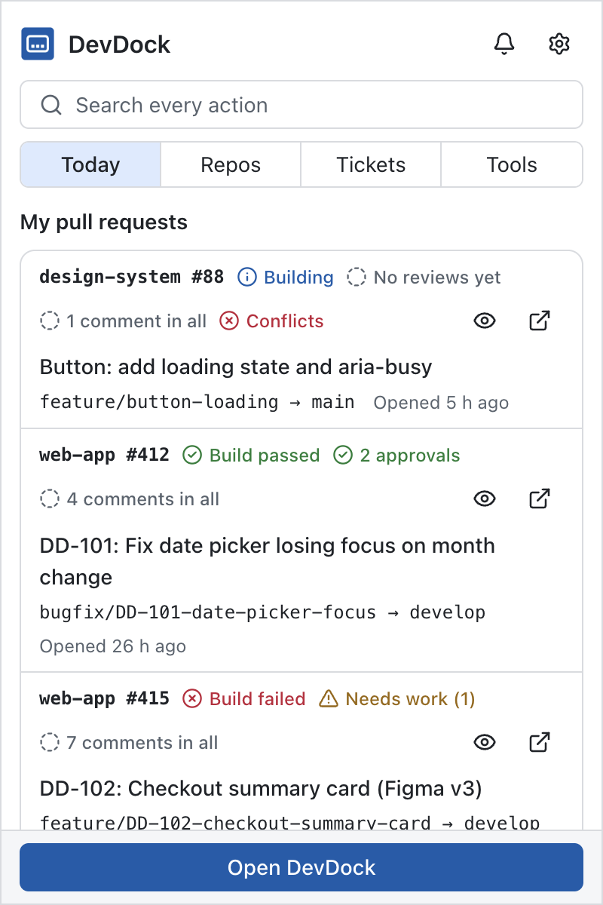

**Today** — your pull requests with build, review and comment state; watched PRs and builds;
tickets in progress; every repo's branch and sync status.

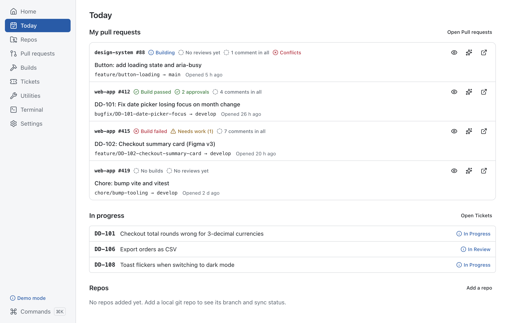

**Repos** — add local git repos; fetch, sync the base branch, update your branch (merge or
rebase, stashing if needed), new branch, push — every git command is shown before it runs, and
conflicts stop safely with Abort. Start and stop the dev server and see its log.

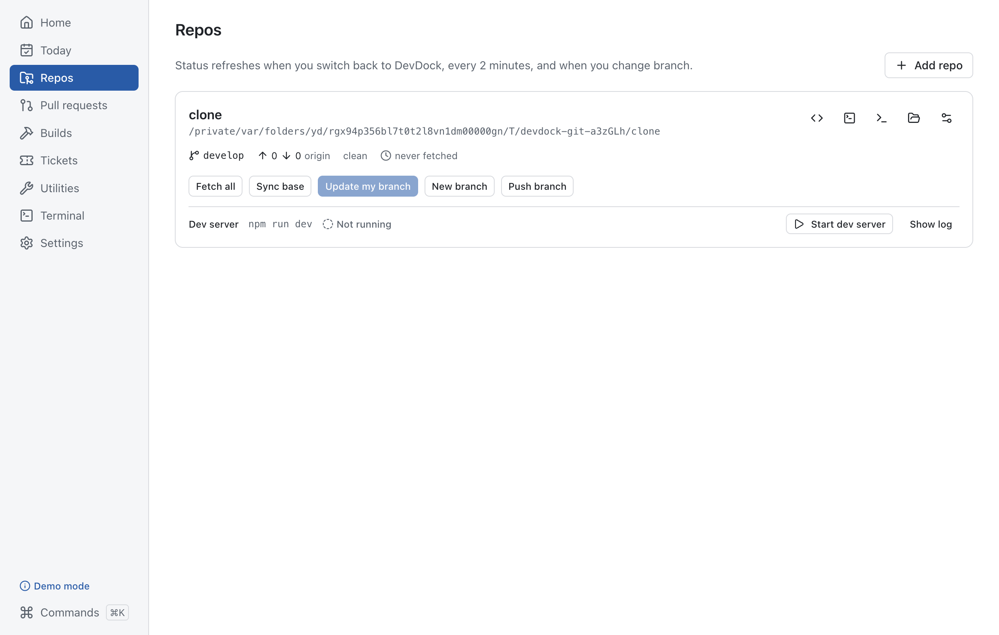

**Pull requests** — yours, the ones waiting for your review, recently merged, and watched ones
(paste a link). Notifications when a build, review or comment changes. Approve, needs work and
merge can be turned on in Settings → Bitbucket.

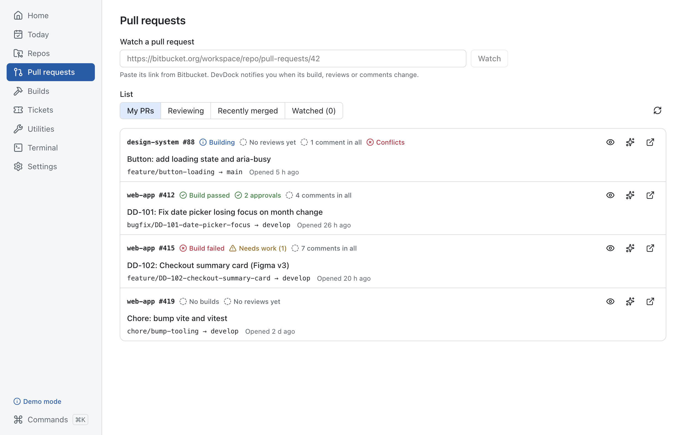

**Builds** — Jenkins builds of your branches and your PRs' pipelines, stages and the live
console; watch a build, a job or your branch's deploy and get notified when it finishes.
Triggering builds is off by default and never offered for protected jobs.

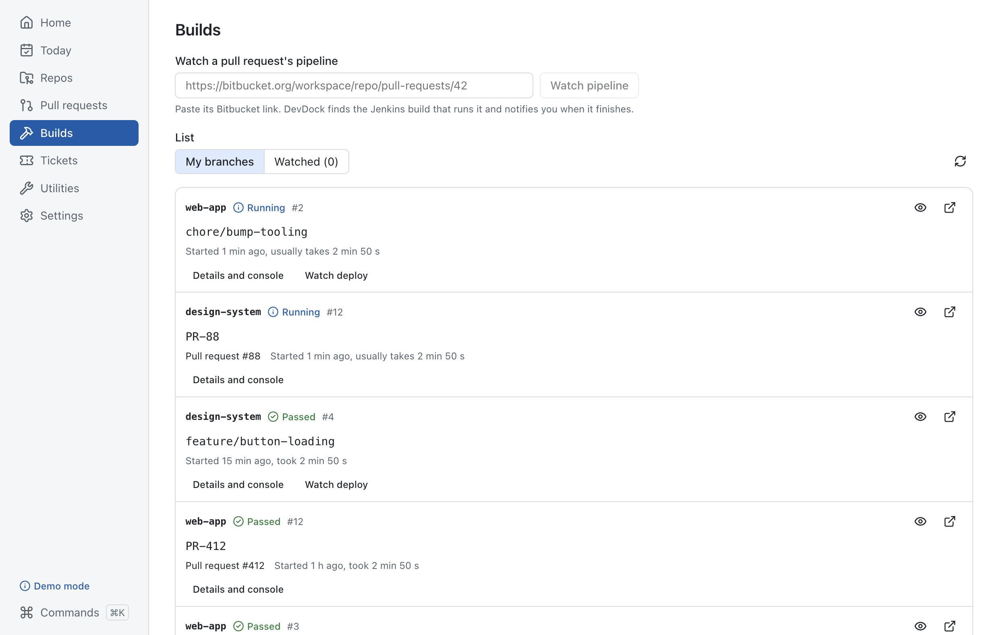

**Tickets** — your Jira issues, the current sprint and saved queries. **Start work** makes the
branch from a fresh base, writes a ticket brief (`docs/ai/specs/<KEY>/TICKET.md`) and copies a
ready message for your coding agent.

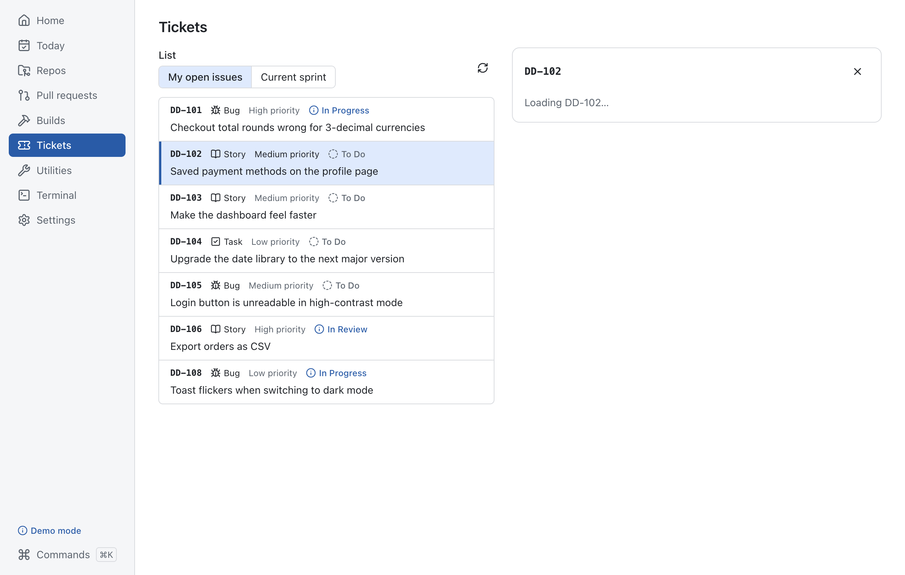

**Agent lessons** (Utilities → Lessons) — DevDock gathers what reviewers keep asking for on
your pull requests; you pick and edit the ones worth keeping, and they're added to
`docs/ai/LESSONS.md` in the repo. Start work tells your agent to read that file first and to
add what it learns. DevDock itself makes no AI calls: your agent in VS Code does the work.

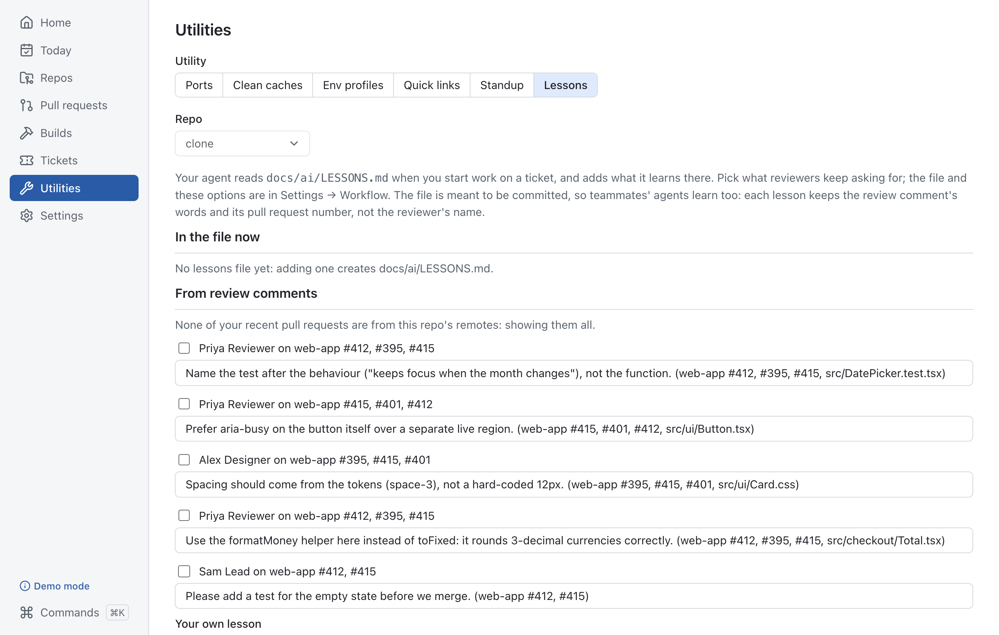

**Utilities** — ports (who's listening, stop it safely), clean build caches, env profiles
(switch `.env.local` safely; values stay encrypted and masked), quick links, and a standup draft
from your own commits, PRs and ticket moves.

**Terminal** — your own shell in tabs, inside DevDock: your login shell (zsh, bash, fish;
PowerShell on Windows) with your own setup, so an oh-my-zsh prompt and plugins look as they do
in Terminal.app, in colours matched to each DevDock theme. Open one in a repo from its card, the
menu-bar panel or the palette (`terminal <repo>`). Find (`⌘F`), copy, paste, clear; `F6` leaves
the terminal for the rest of the app. No oh-my-zsh? Settings → Terminal → **Use DevDock prompt**
gives zsh and bash a robbyrussell-style prompt with the git branch — your `.zshrc` is never
changed. Closing a tab or quitting DevDock stops the shell and what it started.

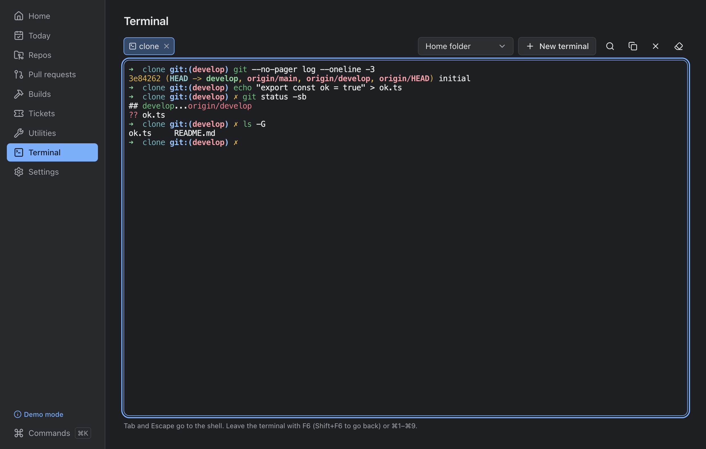

**Command palette** — every action, searchable: `⌘K` in the app, or the global shortcut from
any app. It takes arguments: `watch <PR link>`, `pipeline <PR link>`, `branch NM-1234`,
`kill 5173`, `open <link name>`, `terminal <repo>`. Recent commands come first; a command that can't run says why.

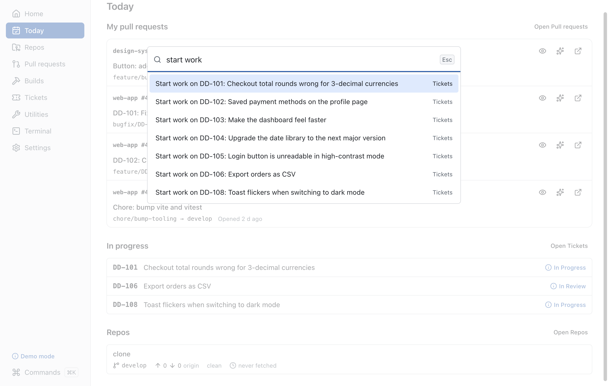

**Settings** — appearance (five themes, font size, density), terminal (shell, font size, cursor,
scrollback, DevDock prompt), accessibility (reduce motion,
larger click targets, underlined links, an always-visible focus ring, screen-reader announcements
of notifications), notifications (types, quiet hours,
history), services and credentials, workflow options (lessons, Start work follow-ups), and
**Diagnostics**: versions, the proxy in use (or your own), Test all connections, and a report
to send with a bug.

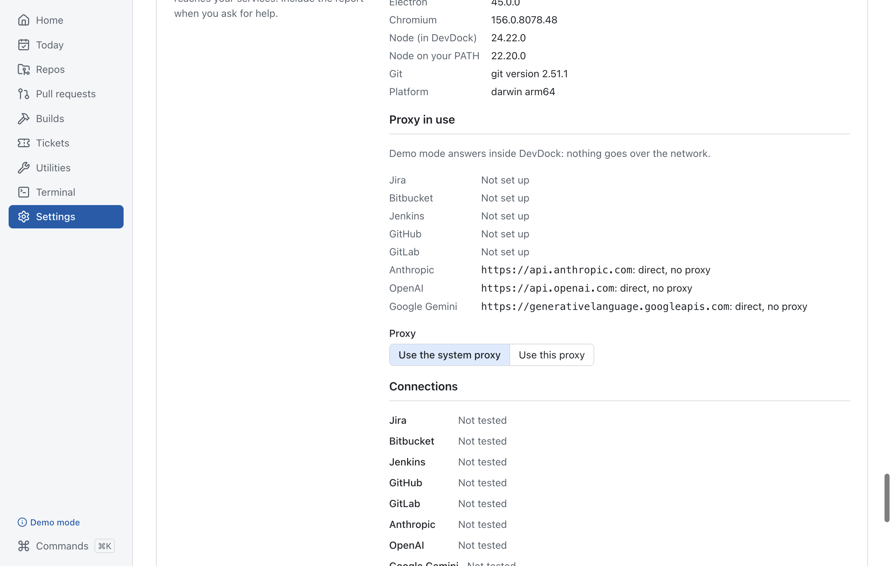

## Connect your services

Turn off demo mode, then enter each service's address in **Settings** and its token in
**Settings → Credentials**. Use **Test connection** (or Diagnostics → Test all connections) to
check. DevDock asks only for read access unless you turn on an action that writes.

**Jira**

- _Cloud_ (`*.atlassian.net`): your account email (Settings → Jira) and an **API token** from
  <https://id.atlassian.com/manage-profile/security/api-tokens>. Not your password, not a
  personal access token.
- _Data Center / Server_: a **personal access token** (profile → Personal Access Tokens), sent
  as Bearer. Some sites restrict REST API access; ask your admin if Test connection says so.
- Permissions: browse the projects you work in. Moving an issue to In Progress on Start work is
  off by default (Settings → Jira) and needs the transition permission.

**Bitbucket**

- _Cloud_ (`bitbucket.org`): an **API token** (or app password) with read access to _account_,
  _repositories_ and _pull requests_; add _write_ on pull requests only if you turn on PR
  actions. With an API token, put your Atlassian email in Settings → Bitbucket → user name;
  leave it empty for a repository/workspace access token. Cloud lists PRs per repository, so add
  your repos (with their bitbucket.org remote) in Repos.
- _Data Center_: an **HTTP access token** with repository **read** (write for PR actions),
  sent as Bearer. Use **Detect** to check the server address.

**Jenkins**

- Your Jenkins user name and an **API token** (your user → Security → API Token).
- Permissions: Overall/Read and Job/Read. Job/Build only if you allow triggers for specific
  jobs (Settings → Jenkins); protected jobs are never triggered.
- Add your multibranch jobs (or folders) as paths or links; set a deploy job to follow your
  branch's deploys.

**Proxy:** DevDock uses your system proxy (including PAC/automatic configuration). If your
company needs a specific one, set it in **Settings → Diagnostics → Proxy**.

## Security in plain words

- **Tokens** are stored encrypted by your operating system (macOS Keychain, Windows DPAPI) and
  only the background part of DevDock reads them; the screens never see them. They aren't in
  settings files, exports, logs or diagnostics.
- **Nothing changes without you.** Pushing, merging, approving, triggering a build, moving an
  issue or stopping a process always shows exactly what will happen and waits for you; git
  commands are shown before they run, and protected branches and jobs are refused.
- **Only your services.** DevDock talks to the Jira, Bitbucket and Jenkins addresses you enter,
  and opens links only on hosts you allow (Settings → Links). There's no telemetry, no account,
  and no AI service: demo mode makes no network calls at all.
- **The terminal is your shell.** It runs with your permissions, like Terminal.app; the screens
  only send keystrokes to it, and only to their own terminals. It starts in a repo you added or
  your home folder.
- **Your files stay yours.** It writes only where you ask: ticket briefs and lessons in your
  repo (or briefs in DevDock's own folder — Settings), env profile backups, its settings and
  logs. Env profile values are encrypted at rest and masked until you reveal one.
- **Logs and the diagnostics report** have credentials removed; the report also replaces your
  names, emails and home folder. Settings → Data → Clear all data removes everything DevDock
  stored.

## Keyboard shortcuts

| Shortcut (macOS / Windows)        | Does                                                                              |
| --------------------------------- | --------------------------------------------------------------------------------- |
| `⌘K` / `Ctrl+K`                   | Command palette (in the app)                                                      |
| `⌘⇧Space` / `Ctrl+Shift+Space`    | Command palette from any app (change it in Settings → General)                    |
| `⌘1` … `⌘9` / `Ctrl+1` … `Ctrl+9` | Home, Today, Repos, Pull requests, Builds, Tickets, Utilities, Terminal, Settings |
| `F6` / `Shift+F6`                 | In a terminal: leave it, forwards / backwards (Tab goes to the shell)        |
| `⌘F` / `Ctrl+F`                   | In a terminal: find in its scrollback                                             |
| `⌘,` / `Ctrl+,`                   | Settings                                                                          |
| `↑` `↓` `Enter`                   | Move through and run palette results                                              |
| `Esc`                             | Close the palette, a dialog or the menu-bar panel                                 |
| `Tab` / `Shift+Tab`               | Every control is reachable from the keyboard, with a visible focus ring           |

## Develop

```sh
npm install
npm run dev          # the app, with demo mode on by default
npm run lint         # eslint + prettier + typecheck
npm test             # unit + integration (vitest)
npm run e2e          # Playwright against the built app
npm run dist         # installers: dmg (arm64 + x64) on macOS, NSIS + portable on Windows
npm run screenshots  # regenerates docs/screenshots (demo mode)
```

Opt-in checks: `DEVDOCK_AUDIT_DIR=<folder> npx playwright test audit` (every screen in every
look) and `DEVDOCK_PERF=1 npx playwright test perf` (idle CPU and memory with 5 repos and 10
watched items; last run 0.34 % CPU, see DECISIONS P6-C).

### Checking "stop a process by port" on Windows

CI covers the Windows port scanner and stop path with unit tests that mock `execFile`
(`tests/unit/ports.test.ts`); the end-to-end test that kills a real process runs on macOS only.
To check it by hand on Windows:

1. In PowerShell, start something listening, e.g. `npx --yes http-server -p 5174` (or any dev
   server), and note its port.
2. In DevDock open **Utilities → Ports**, pick the **5173–5180** filter (or type the port). The row
   shows the port, `node.exe` and its PID; `netstat -ano -p tcp | findstr :5174` should show the
   same PID.
3. Press **Stop** and confirm: DevDock runs `taskkill /PID <pid> /T`. The port should be free
   afterwards (`netstat` shows nothing for it).
4. If the process ignores the request, DevDock says so and offers **Force stop**; confirming that
   runs `taskkill /PID <pid> /T /F`.
5. From the command palette (`Ctrl+K`), `kill 5174` opens the same stop dialog.

Processes of another user, or that need admin rights, are refused with Windows' own message under
**Details**.

## Licence

MIT — see [LICENSE](LICENSE). Bundled libraries keep their own licences (`THIRD_PARTY_NOTICES.txt` in the app).
